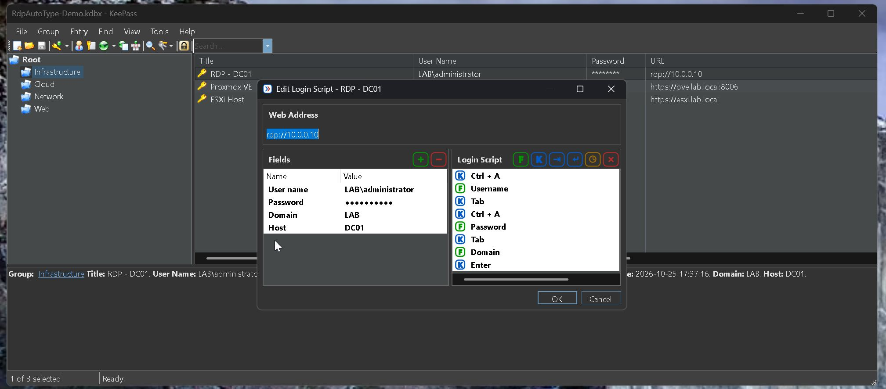
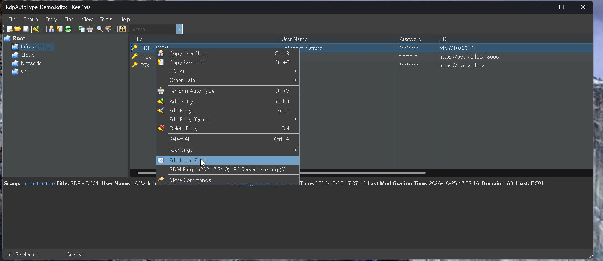
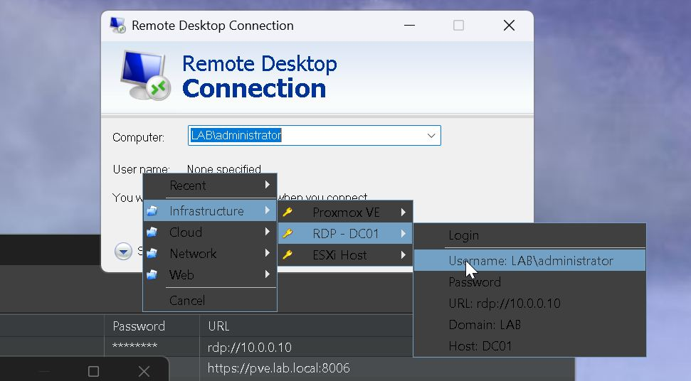

# RdpAutoType

**Tired of copy‑pasting passwords and alt‑tabbing between KeePass and whatever
you're signing into?** RdpAutoType types them for you — in ordinary windows
**and** in the awkward ones (nested RDP, remote consoles) where normal
auto‑type simply gives up.

A KeePass 2.x plugin that types your credentials **through nested RDP sessions
and remote consoles** — places where KeePass's built‑in auto‑type and most
password managers fail.

It injects keystrokes at the scan‑code level (real hardware make/break codes,
with keyboard‑layout synchronization), so the keys survive redirection through
RDP, and RDP‑inside‑RDP. It also adds a cursor popup menu, a configurable
mouse/keyboard activator, and a visual **Login Script** editor.

This is an open‑source, clean‑room implementation: written from a behavioral
specification, with no decompiled code.

## Screenshots

Visual Login Script editor (Fields + the auto‑type sequence):



Right‑click an entry → Edit Login Script:



Cursor popup menu with per‑entry fields:



## Features

- **Scan‑code typing engine** that works through simple and nested RDP.
- **Cursor popup menu**: Recent entries, groups as submenus,
  KeePass icons, and per‑entry field list + Login.
- **Activators**:
  - Global hotkey (default `Ctrl+Alt+Space`).
  - Mouse activator — left/middle/right button, optional `Ctrl/Shift/Alt`,
    single or double click, with actions: launch popup, run most‑recent entry,
    or run the entry associated with the active window.
- **Visual Login Script editor** (right‑click an entry → *Edit Login Script…*):
  side‑by‑side Fields | Login Script, drag‑to‑reorder, add Field/Key/Delay
  elements. Reads and writes the entry's **native** KeePass auto‑type sequence
  (`{USERNAME}{TAB}{S:Field}…`) and custom string fields — fully compatible with
  KeePass and other plugins.
- Default login script: `Ctrl+A, Username, Tab, Ctrl+A, Password, Enter`
  (the `Ctrl+A` clears any pre‑filled text before typing).
- Configurable timing (between characters, key press/release) and a
  configurable **Edit Login Script** shortcut (default `Ctrl+Enter`).

## Requirements

- Windows
- KeePass 2.x
- .NET Framework 4.8 (ships with current Windows 10/11)

## Install

1. Download `RdpAutoType.dll` from the [Releases](../../releases) page.
2. Copy it into your KeePass `Plugins` folder, e.g.
   `C:\Program Files\KeePass Password Safe 2\Plugins\`.
3. **Unblock** the file (Windows marks files from other machines):
   right‑click → *Properties* → *Unblock*, or
   `Unblock-File "...\Plugins\RdpAutoType.dll"` in PowerShell.
4. Restart KeePass. Verify under *Tools → Plugins*.

> Login scripts are stored inside your `.kdbx` database, so they travel with it.
> Plugin settings are stored in KeePass's local config, per machine.

## Usage

- Press the activator (default `Ctrl+Alt+Space`, or your configured mouse
  button) to open the popup menu at the cursor; pick an entry → **Login** to run
  its login script, or pick a single field to type just that value.
- Right‑click an entry (or `Ctrl+Enter`) → **Edit Login Script…** to build the
  sequence visually.
- *Tools → RdpAutoType → Settings…* for activator, timing, components and the
  shortcut.

> Note: typing into a local **VMware** console window is not supported (the
> guest doesn't accept the injected input); typing through **RDP to a VM** works.

## Build from source

Requires MSBuild (Visual Studio) and the .NET Framework 4.8 targeting pack.
KeePass.exe is referenced for the plugin API; point the build at it if it isn't
in the default location:

```
msbuild RdpAutoType\RdpAutoType.csproj /p:Configuration=Release ^
  /p:KeePassExe="C:\Program Files\KeePass Password Safe 2\KeePass.exe"
```

The output is `RdpAutoType\bin\Release\RdpAutoType.dll`.

## License

GPL‑2.0 — see [LICENSE](LICENSE). KeePass itself is GPL‑2.0+.
